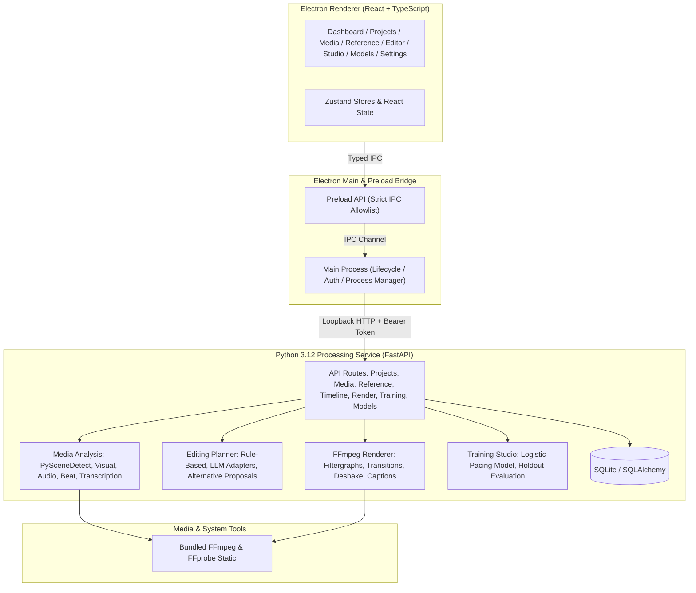

# System Overview

ReelForge AI is an offline-first desktop video editor with AI-assisted editing, reference-video style learning, and local machine-learning preference training.

## Architectural Layers

## Security & Boundary Architecture

1. **Renderer Isolation**:
   - `contextIsolation: true`
   - `nodeIntegration: false`
   - `sandbox: true`
   - No direct access to Node.js, child processes, or filesystem from the renderer.
2. **IPC Bridge**:
   - Explicit typed channel allowlist defined in `apps/desktop/src/shared/ipc-contract.ts`.
   - IPC payload validation prevents arbitrary input injection.
3. **Local Processing Service**:
   - Spawns as a dedicated child process bound exclusively to `127.0.0.1` on a dynamic OS-assigned port.
   - Requires a per-session cryptographically random bearer token generated by Electron.
   - Graceful termination on app close (SIGTERM with fallback to SIGKILL).
4. **Media & Execution Safety**:
   - All FFmpeg subprocess arguments are constructed as safe parameter arrays (never shell strings).
   - Render destination paths are strictly validated to prevent directory traversal outside authorized export directories.
   - Original user media files are never overwritten or deleted.
