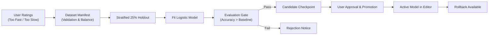

# Training Studio Guide

The Training Studio provides real, local machine-learning model training to refine editing pacing preferences based on your explicit editing ratings.

## Conceptual Framework

Unlike generic deep learning or generative video tools, ReelForge AI does **not** hallucinate video frames or alter human subjects. The Training Studio trains a lightweight, auditable preference model that learns whether you prefer faster or slower cuts for a given reel duration and footage quantity.

## The Training Lifecycle

## Step-by-Step Training Workflow

1. **Provide Feedback in the Editor**:
   - As you generate and review timelines, click the **"Too Fast"** or **"Too Slow"** buttons in the Editor.
   - At least **8 ratings** (with at least 3 in each direction) are required to build a balanced dataset.
2. **Inspect the Dataset Manifest**:
   - Open the **Training Studio** page.
   - The *Feedback Dataset Manifest* card displays total samples, class distribution, and balance status.
3. **Train the Model**:
   - Click **"Train from feedback"**.
   - Training runs as a background process with real-time stage progress reporting and cancellation support.
4. **Evaluate the Candidate**:
   - The candidate model is tested against a deterministic 25% stratified holdout set.
   - It must exceed the majority-class baseline and chance-level balanced accuracy to pass the promotion gate.
5. **Promote or Roll Back**:
   - Click **"Promote evaluated candidate"** to activate the new model.
   - If desired, click **"Roll back"** at any time to restore the previous model version.
